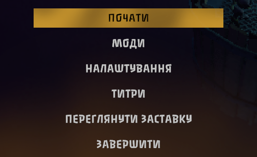

# POG Fonts

Cyrillic letters for the Pit of Goblin main menu font.

The main menu is drawn in Passero One, a font with no Cyrillic letters at all. So when you switch the game to Ukrainian or Russian, every menu button falls back to a plain sans-serif and the menu loses its look. This mod adds the missing letters, drawn to match the original, so that «ПОЧАТИ» and «НАЛАШТУВАННЯ» look as if the font had always had them.



## A note from me

I'm not a type designer. I tried to build every letter out of the font's own pieces: Cyrillic letters that look like Latin ones are simply the Latin glyphs (А В Е К М Н О Р С Т Х І), some are mirrored (И from N, Я from R), and the rest are put together from parts of existing glyphs. Ц and Щ borrow the tail of Q, Ч is a turned h, Л and Д use the leg of A, and Б and Ь are built on b. Then I smoothed the joins.

Some letters came out better than others. If you know how to make any of them better, or you want to do the same for another language, I'd be glad to hear from you. Open an issue or a pull request on [GitHub](https://github.com/largoz/POGFonts). The scripts that build the font are in the repository too.

## What it covers

- The whole Ukrainian and Russian alphabets, upper and lower case: 74 letters, from А to Я and а to я, plus Ґ Є І Ї Ё Ъ Ы Э.
- Text the game draws in Passero One, which is the main menu.
- Text that uses the game's other fonts is not changed.

## Choosing a font

Goblin Menu is on by default. To switch back to the game's own look, or to a font of your own:

- **With [POG Config](https://thunderstore.io/c/pit-of-goblin/p/Largo/POG_Config/):** open MODS, then POG Fonts, and pick **Vanilla**, **Goblin Menu (Cyrillic)** or one of your fonts for the menu font. The change shows at once.
- **Without it:** in `UserData/MelonPreferences.cfg`, under `[POG_Fonts]`, set `PasseroOne_Regular_SDF` to `"Vanilla"`, `"Goblin Menu (Cyrillic)"` or the name of your font file without its extension.

Vanilla means exactly what the game shows without this mod.

## Your own fonts

You can add letters to any of the game's fonts without writing code:

1. Make a folder in `UserData/POGFonts/` named after the game font, for example `UserData/POGFonts/PasseroOne-Regular SDF/`.
2. Put a `.ttf` or `.otf` file into it.
3. Restart the game. Your font appears in the list under its file name.

Your font only supplies the letters the game font doesn't have, so its Latin letters, if it has any, are not used where the game already has them. If the mod has no font of its own for that game font, yours is used by default.

Game font names, as the mod lists them in the MelonLoader log on startup: `PasseroOne-Regular SDF` (main menu), `RulerGold SDF`, `Roboto-Medium SDF`, `LiberationSans SDF`, `NotoSansJP-SemiBold SDF`, `NotoSansSC-SemiBold SDF`, `NotoSansTC-SemiBold SDF`, `ZCOOLKuaiLe-Regular SDF`.

## How it works

Nothing in the game files is changed. When a game font loads, the mod builds the chosen font from its file and puts it at the front of that game font's fallback list. TextMeshPro only looks there for letters the game font doesn't have. Latin text looks exactly as before, and other languages are not affected.

On its first run the mod writes Goblin Menu and its license to `UserData/POGFonts/`, because TextMeshPro reads letters from the file as they are needed.

To remove the mod, delete `POGFonts.dll`.

## Installation

- With a mod manager: just install it.
- By hand: put `POGFonts.dll` into the game's `Mods` folder. You need MelonLoader 0.7.2 or newer.

It works on its own. POG Config is optional and only adds the settings page.

## License

The font is under the SIL Open Font License 1.1 ([font/OFL.txt](https://github.com/largoz/POGFonts/blob/main/font/OFL.txt)). It is based on Passero One by Viktoriya Grabowska (Sorkin Type Co.). "Passero" is a Reserved Font Name under that license, so the modified font is called Goblin Menu.

---

## Українською

Головне меню гри намальоване шрифтом Passero One, у якому немає жодної кириличної літери. Тому українською кнопки меню малюються звичайним шрифтом без засічок. Цей мод додає кирилицю, намальовану під оригінал.

Я не шрифтовий дизайнер. Кожну літеру я намагався зібрати з частин самого шрифту: літери, однакові з латиницею, взяті як є, частина віддзеркалена, решта складена зі шматків інших гліфів і згладжена. Деякі вийшли краще, деякі гірше. Якщо знаєте, як зробити краще, або хочете зробити так само для іншої мови, пишіть на [GitHub](https://github.com/largoz/POGFonts). Там є й скрипти, якими зібрано шрифт.

Шрифт можна перемкнути в POG Config (MODS → POG Fonts): **Vanilla** дає вигляд гри без мода, **Goblin Menu (Cyrillic)** — наш шрифт, а також є ваші власні шрифти. Свій шрифт можна додати без коду. Створіть теку з назвою шрифту гри, наприклад `UserData/POGFonts/PasseroOne-Regular SDF/`, покладіть туди `.ttf` чи `.otf` і перезапустіть гру.

Мод нічого не змінює у файлах гри й не чіпає латиницю. Щоб прибрати його, видаліть `POGFonts.dll`.

---

## For developers

Build against your game install (the folder with `MelonLoader/`):

```sh
dotnet build POGFonts.csproj -c Release -p:GameDir="<game folder>"
```

`python build_and_deploy.py` builds and copies the DLL into the game's `Mods` folder. The font is embedded in the DLL. How it was made and how to rebuild it is described in [font/README.md](font/README.md).
