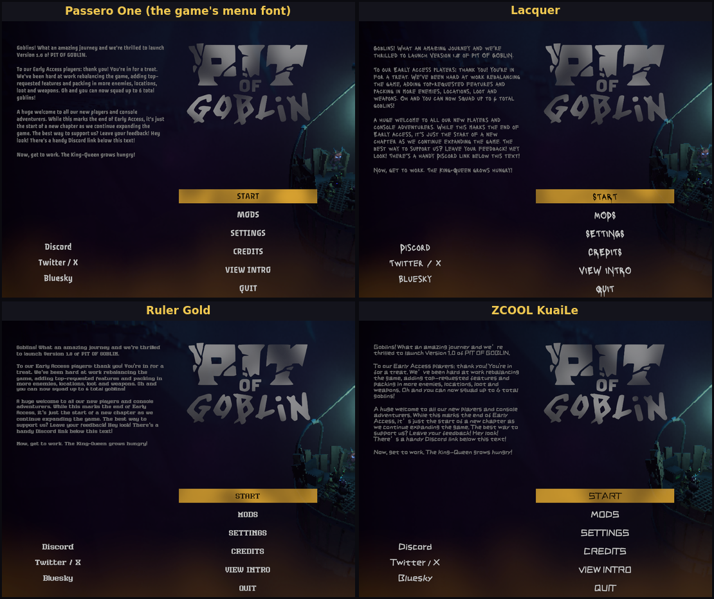
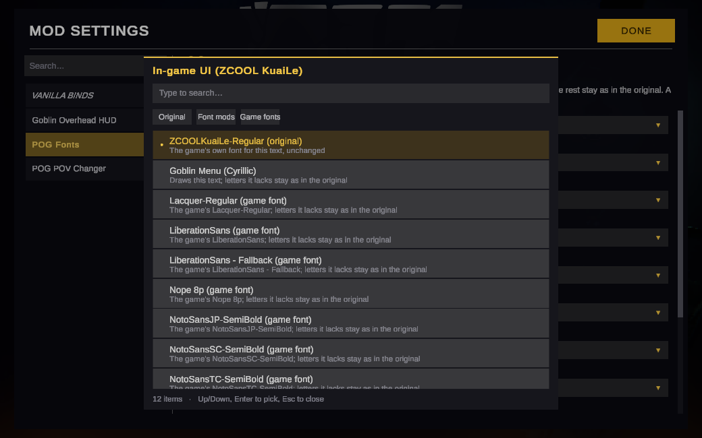

# POG Fonts

A font manager for Pit of Goblin. Pick the font for each kind of text in the game: the main menu, the in-game UI, the lift displays, the painted signs, the price tags and the rest. Choose one of the game's own fonts or a font mod. Every change shows at once.



## Choosing fonts

Open MODS, then POG Fonts ([POG Config](https://thunderstore.io/c/pit-of-goblin/p/Largo/POG_Config/) 1.1.0 or newer shows a list with search and filters; older versions show sliders). Each kind of text has a row that says where it shows up in the game. Its list starts with the original font, followed by the installed font mods and the game's other fonts.



**A chosen font draws only the letters it has. Every other letter stays as in the original.** Set the menu to a font without Cyrillic and play in Ukrainian: the Latin text changes, the Cyrillic stays as it was.

Without POG Config, set the choices in `UserData/MelonPreferences.cfg` under `[POG_Fonts]`: `"Vanilla"` for the original, `"Replace: <font mod name>"`, or `"Replace: <game font> (game)"`, for example `PasseroOne_Regular_SDF = "Replace: Lacquer-Regular (game)"`.

## Font mods

A font mod can be made for one of the game's fonts, like [Goblin Menu Cyrillic](https://thunderstore.io/c/pit-of-goblin/p/Largo/Goblin_Menu_Cyrillic/) for the menu font. It then becomes part of that font's original and fills in the letters the font lacks, whatever is chosen. To see the game exactly as it was, disable that font mod in your mod manager. Every font mod can also be picked for any other kind of text.

## Making a font mod

A font mod is a Thunderstore package with no code. Copy [packs/GoblinMenuCyrillic](https://github.com/largoz/POGFonts/tree/main/packs/GoblinMenuCyrillic) as a template:

```
manifest.json                         the usual package manifest, with "Largo-POG_Fonts-1.2.0" in "dependencies"
icon.png                              256x256
README.md
CHANGELOG.md
Mods/<Author>-<Name>/pogfont.json     what the font is, and which game font it is made for
Mods/<Author>-<Name>/MyFont.ttf       the font (.ttf or .otf)
Mods/<Author>-<Name>/OFL.txt          the font's license, if it has one
```

Keep the font files in that `Mods/<Author>-<Name>/` folder. Gale unpacks files outside `Mods/` loose into the profile's `Mods/`, where every font mod's `pogfont.json` would land on the same path; r2modman puts the whole package into its own folder. With the files in a folder of their own, both managers keep each font mod apart, and POG Fonts finds them anywhere under `Mods/`. `python build_pack.py <folder>` from the repository zips a pack and refuses the wrong layout.

`pogfont.json`:

```json
{
  "format": 1,
  "name": "My Font",
  "font": "MyFont.ttf",
  "target": "PasseroOne-Regular SDF",
  "sample": "ĄĆĘŁŃÓŚŹŻ"
}
```

- `name` is what players see in the lists.
- `font` is the file, in the same folder as `pogfont.json`.
- `target` is the game font it is made for. Its letters fill in what that font lacks. Game font names: `PasseroOne-Regular SDF` (main menu), `ZCOOLKuaiLe-Regular SDF` (in-game UI), `RulerGold SDF` (lift displays), `Lacquer-Regular SDF` (painted signs), `Nope 8p SDF` (price tags), `Roboto-Medium SDF`, `LiberationSans SDF`, `NotoSansJP-SemiBold SDF`, `NotoSansSC-SemiBold SDF`, `NotoSansTC-SemiBold SDF`. POG Fonts also lists them in the MelonLoader log at startup.
- `sample` is optional: a few of your letters. After loading, POG Fonts checks where each one is drawn from and warns in the log if it is not your font.

To try a font without making a package, put the font file into `UserData/POGFonts/<game font name>/`, for example `UserData/POGFonts/PasseroOne-Regular SDF/MyFont.ttf`, and restart the game.

How Goblin Menu was drawn, with the scripts, is in [font/README.md](https://github.com/largoz/POGFonts/blob/main/font/README.md).

## How it works

Nothing in the game files is changed. TextMeshPro, which draws the game's text, takes each letter from the text's font, or else from the first font in that font's fallback list that has it. POG Fonts works on those fonts, not on the texts:

- **Original**: the game font with its own letters, then the font mods made for it, then the game's own fallbacks.
- **Another font chosen**: the game font's own letters are switched off. Its fallback list starts with the chosen font (only that font's own letters), then a copy of the original, then the font mods made for it. Every text using that font changes, outlines and shadows included, and so does every text created later.

When you switch, TextMeshPro's memory of letters it already found is cleared, so no letter stays in the old font.

## Installation

- With a mod manager: install POG Fonts, or a font mod, which brings it along.
- By hand: put `POGFonts.dll` into the game's `Mods` folder. You need MelonLoader 0.7.2 or newer.

POG Config is optional and only adds the settings page. The game's own fonts can be swapped without any font mod.

---

## For developers

Build against the folder that holds `MelonLoader/` (with its generated `Il2CppAssemblies/`) and `Mods/`: the game folder for a plain MelonLoader install, or the mod manager profile (for Gale, `~/.local/share/com.kesomannen.gale/pit-of-goblin/profiles/<profile>`):

```sh
dotnet build POGFonts.csproj -c Release -p:GameDir="<that folder>"
python build_pack.py packs/GoblinMenuCyrillic     # zip a font mod for Thunderstore
```

`python build_and_deploy.py` builds and copies the DLL into the game's `Mods` folder.
