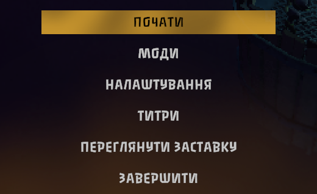

# Goblin Menu Cyrillic

Cyrillic letters (Ukrainian and Russian) for the Pit of Goblin main menu font.

The main menu is drawn in Passero One, a font with no Cyrillic letters at all. So when you switch the game to Ukrainian or Russian, every menu button falls back to a plain sans-serif and the menu loses its look. This font adds the missing letters, drawn to match the original, so that «ПОЧАТИ» and «НАЛАШТУВАННЯ» look as if the font had always had them.

## A note from me

I'm not a type designer. I tried to build every letter out of the font's own pieces: Cyrillic letters that look like Latin ones are simply the Latin glyphs (А В Е К М Н О Р С Т Х І), some are mirrored (И from N, Я from R), and the rest are put together from parts of existing glyphs. Ц and Щ borrow the tail of Q, Ч is a turned h, Л and Д use the leg of A, and Б and Ь are built on b. Then I smoothed the joins.

Some letters came out better than others. If you know how to make any of them better, I'd be glad to hear from you. Open an issue or a pull request on [GitHub](https://github.com/largoz/POGFonts). The scripts that build the font are there too.

## What it covers

- The whole Ukrainian and Russian alphabets, upper and lower case: 74 letters, from А to Я and а to я, plus Ґ Є І Ї Ё Ъ Ы Э.
- Text the game draws in Passero One, which is the main menu.
- Text that uses the game's other fonts is not changed.

## Installation

Needs [POG Fonts](https://thunderstore.io/c/pit-of-goblin/p/Largo/POG_Fonts/), the font manager; a mod manager installs it for you. Once installed, this font is used right away. To go back to the game's own look, pick **Vanilla** for the menu font in POG Config (MODS, then POG Fonts).

By hand: put this whole folder, with `pogfont.json` in it, anywhere inside the game's `Mods` folder.

## License

SIL Open Font License 1.1 ([OFL.txt](https://github.com/largoz/POGFonts/blob/main/packs/GoblinMenuCyrillic/OFL.txt)). Based on Passero One by Viktoriya Grabowska (Sorkin Type Co.). "Passero" is a Reserved Font Name under that license, so the modified font is called Goblin Menu.
